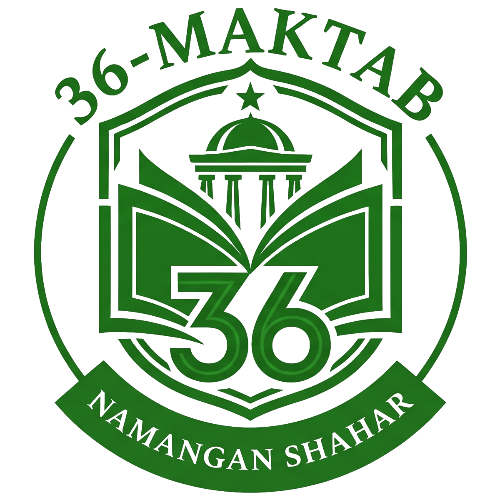

<div align="center">

  

  # Namangan Shahar 36-sonli Umumta’lim Maktabi
  ### Rasmiy Veb-Portali • Official Web Portal

  <p align="center">
    O‘zbekiston Respublikasi, Namangan viloyati, Namangan shahri 36-sonli davlat umumta’lim maktabining zamonaviy, Apple-uslubidagi ekotizim va 3 tilda ishlovchi rasmiy portali.
  </p>

  <p align="center">
    <a href="https://react.dev/"></a>
    <a href="https://www.typescriptlang.org/"></a>
    <a href="https://vitejs.dev/"></a>
    <a href="https://tailwindcss.com/"></a>
    <a href="https://xakimdjanov.uz/"></a>
  </p>

  <p align="center">
    <a href="#-asosiy-imkoniyatlar">Asosiy imkoniyatlar</a> •
    <a href="#-loyihaning-sahifalari-va-tuzilishi">Sahifalar</a> •
    <a href="#-dizayn-va-ranglar-palitrasi">Dizayn tizimi</a> •
    <a href="#-texnologiyalar-steki">Texnologiyalar</a> •
    <a href="#-ishga-tushirish">Ishga tushirish</a> •
    <a href="#-muallif-va-ishlab-chiqaruvchi">Muallif</a>
  </p>
</div>

---

## 🏛 Maktabning Rasmiy Rekvizitlari

| Ma'lumot turi | Rasmiy qiymat |
| :--- | :--- |
| **Muassasa nomi** | Namangan shahar 36-sonli umumta’lim maktabi |
| **Maktab direktori** | Jalilov Axadjon Xolikovich |
| **Joylashuv** | Namangan shahri, Namangan viloyati, O‘zbekiston |
| **Rasmiy telefon** | [+998 69 224-44-06](tel:+998692244406) |
| **Elektron pochta** | [namangan36m@umail.uz](mailto:namangan36m@umail.uz) |
| **Ish tartibi** | Dushanba – Shanba: 08:00 – 17:00 |
| **Davlat portali** | [eMaktab tizimi](https://emaktab.uz) bilan integratsiyalangan |

---

## ✨ Asosiy Imkoniyatlar

- 🍏 **Apple Design Principles**:
  - Yupqa yarim shaffof orqa fonlar (`backdrop-blur-md`, `bg-white/80`).
  - Silliq animatsiyalar: menyuning tepadan silliq ochilishi (`animate-menu-slide-down`), orqa fon fade effekti va modallarning mayin paydo bo'lishi (`animate-modal-pop`).
  - Nozik soya (`shadow-sm`, `shadow-xl`), 1:1 kvadrat ramkali logotip va yumaloqlangan burchaklar (`rounded-2xl`, `rounded-3xl`).

- 🌐 **To‘liq 3 Tilda Xalqarolashtirish (i18n)**:
  - 🇺🇿 **O‘zbekcha (Lotin)** — Birlamchi rasmiy til
  - 🇷🇺 **Русский (Кириллица)**
  - 🇬🇧 **English**
  - Header, menyu, barcha bo'limlar, statistika, jadval va footer bir zumda qayta yuklanmasdan tanlangan tilga moslashadi. Til holati URL (`?lang=uz|ru|en`) va xotirada saqlanadi.

- 📱 **Ekstremal Moslashuvchanlik (Mobile-First 300px+)**:
  - 300px, 320px, 360px, 375px, 390px, 430px va undan katta bo'lgan barcha qurilmalarda gorizontal siljishsiz (zero horizontal scrollbar) qat'iy tekis ko'rinish.
  - Mobil menyu ochilganda boshqa elementlar orqasida qolib ketmaydi (`z-[9999]`).

- 🪟 **Mustaqil Modallar Ekotizimi (React Portals)**:
  - Yangiliklar batafsil modal oynasi va Maktab nizomi/hujjatlari `createPortal(..., document.body)` yordamida to'g‘ridan-to‘g‘ri brauzer ildiziga ulanadi (`z-[999999]`), natijada hech qachon sticky header ortida qolmaydi.

- ⏰ **Qat'iy 12 Ustunli Dars va Qo‘ng‘iroqlar Jadvali**:
  - Tanaffus daqiqalari matn uzunligidan qat'iy nazar soatlar bir chiziqda tekislangan (`grid grid-cols-12`: 3-ustun dars raqami, 5-ustun vaqt kapsulasi, 4-ustun tanaffus ko'rsatkichi).

---

## 📑 Loyihaning Sahifalari va Tuzilishi

Sayt ham yagona interaktiv **Landing Page** (barcha bo'limlarga silliq scroll), ham chuqurlashtirilgan alohida sahifalar tartibida tashkil etilgan:

1. **Bosh sahifa — Home (`/`)**:
   - Hero banner, maktab gerbi, "Kelajak sari bilim bilan!" shiori, raqamli statistika.
   - **Maktab haqida**: Tarix, missiya, qadriyatlar va «Maktabimizning bosh maqsadi» interaktiv bloki.
   - **Maktab direktori & Rahbariyat**: Jalilov Axadjon Xolikovich, direktor o'rinbosarlari, psixolog va maslahatchilar.
   - **O‘qituvchilar**: Fan kafedralari bo'yicha toifalangan ustozlar katalogi (qidiruvsiz, toza katalog).
   - **Yutuqlar va natijalar**: OTMga 92% qabul ko'rsatkichi, xalqaro IELTS/CEFR sertifikatlari va olimpiada faxriylari.
   - **Ta’lim va imkoniyatlar**: Chet tillari, IT & robototexnika, «Qiziqishdan kasb sari» tibbiyot to'garagi.
   - **Yangiliklar va tadbirlar**: Rasmiy xabarlar, fotolavhalar va modalda batafsil mutolaa qilish.
   - **Ota-onalar uchun**: 1-sinf qabuli hujjatlari, maktab formasi, dars jadvali, choraklar taqvimi.
   - **Aloqa**: Qabul vaqtlari, xarita, to'g'ridan-to'g'ri bog'lanish va telefonli tezkor murojaat shakli.
2. **Maktab direktori alohida sahifasi (`/director`)**:
   - Rahbariyat faoliyati, xalqaro ta'lim tajribasi, qabul kunlari va rasmiy bog'lanish.
3. **Qo‘shimcha sahifalar**:
   - O'qituvchilar (`/teachers`), Yutuqlar (`/achievements`), Ta'lim (`/education`), Yangiliklar (`/news`, `/news/:id`), Ota-onalar (`/parents`), Aloqa (`/contact`).

---

## 🎨 Dizayn va Ranglar Palitrasi

Loyiha tabiat va zamonaviy ilm-fan uyg'unligini aks ettiruvchi **Sage Green (Zaytun/Adaçayı yashili)** va shaffof oq tonlar asosida yaratilgan:

```
┌─────────────────────────────────────────────────────────────┐
│  ASOSIY RANG PALITRASI (Sage Green & Clean Ivory)          │
├───────────────────┬───────────────┬─────────────────────────┤
│ Rang nomi         │ HEX Kodi      │ Qo'llanilish sohasi     │
├───────────────────┼───────────────┼─────────────────────────┤
│ Deep Forest Green │ #182B17       │ Asosiy matnlar, Footer  │
│ Sage Primary      │ #4E724B       │ Tugmalar, Aktsent, Gerb │
│ Sage Medium       │ #7F9E7C       │ Borderlar, Hover holat  │
│ Sage Light Tint   │ #8EA98B       │ Ikonkalar, Badge'lar    │
│ Sage Soft Wash    │ #F4F7F4       │ Bo'limlar orqa foni     │
│ Sage Mint Light   │ #EAF2E9       │ Kapsulalar, Chiplar     │
│ Pure White        │ #FFFFFF       │ Kartalar, Yuza          │
└───────────────────┴───────────────┴─────────────────────────┘
```

---

## 💻 Texnologiyalar Steki

- **Yadro**: [React 18.3](https://react.dev/) + [TypeScript 5.6](https://www.typescriptlang.org/)
- **Yig'uvchi (Bundler)**: [Vite 6.0](https://vitejs.dev/) — yuqori tezlikdagi HMR va optimallashtirilgan build
- **Stillar**: [Tailwind CSS 3.4](https://tailwindcss.com/) + PostCSS + Autoprefixer
- **Navigatsiya**: [React Router DOM v6](https://reactrouter.com/)
- **Ikonkalar**: [Lucide React](https://lucide.dev/) (200+ vektorli zamonaviy ikonkalar)
- **Modallar**: React DOM `createPortal` ekotizimi

---

## 📁 Loyiha Kataloglar Strukturasi

```
36-school/
├── public/
│   ├── favicon.svg             # Veb-sayt tab ikonkasi
│   ├── logo.png                # Yangilangan Sage Green 1:1 kvadrat gerb
│   ├── logo_sage.png           # Shaffof fonli variant
│   └── logo_sage_white.png     # Oq fonli variant
├── src/
│   ├── components/             # Qayta ishlatiluvchi UI komponentlar
│   │   ├── Footer.tsx          # Pastki qism, Powered by xakimdjanov, eMaktab
│   │   ├── Navbar.tsx          # Sticky header, til tanlash, Apple Drawer
│   │   ├── SchoolBadge.tsx     # Moslashuvchan maktab gerbi komponenti
│   │   └── TopBar.tsx          # Yuqori ma'lumotlar paneli
│   ├── context/
│   │   └── LanguageContext.tsx # 3 tildagi kontekst provayderi
│   ├── data/                   # Ma'lumotlar bazasi (Modullar)
│   │   ├── schoolInfo.ts       # Maktab pasporti va kontaktlari
│   │   ├── leadershipData.ts   # Direktor, o'rinbosarlar, mutaxassislar
│   │   ├── teachersData.ts     # Ustozlar ro'yxati va kafedralar
│   │   ├── achievementsData.ts # O'quvchilar natijalari va OTM qabullari
│   │   ├── educationData.ts    # To'garaklar va darslar
│   │   ├── newsData.ts         # Yangiliklar va tadbirlar
│   │   ├── parentsData.ts      # Qo'ng'iroqlar jadvali, hujjatlar
│   │   └── translations.ts     # UZ, RU, EN lug'at tarjimalari
│   ├── pages/                  # Marshrut sahifalari
│   │   ├── HomePage.tsx        # Asosiy Landing Page (barcha bo'limlar jamlangan)
│   │   ├── DirectorPage.tsx    # Alohida direktor sahifasi
│   │   ├── TeachersPage.tsx    # O'qituvchilar sahifasi
│   │   ├── AchievementsPage.tsx# Yutuqlar sahifasi
│   │   ├── EducationPage.tsx   # Ta'lim sahifasi
│   │   ├── NewsPage.tsx        # Yangiliklar sahifasi
│   │   ├── ParentsPage.tsx     # Ota-onalar sahifasi
│   │   └── ContactPage.tsx     # Aloqa sahifasi
│   ├── App.tsx                 # Asosiy marshrutlar va App wrapper
│   ├── index.css               # Apple animatsiyalari, Tailwind direktivalari
│   └── main.tsx                # React ildiz fayli
├── index.html                  # HTML5 shabloni (SEO meta teglari bilan)
├── tailwind.config.js          # Tailwind konfiguratsiyasi
├── tsconfig.json               # TypeScript qoidalari
├── vite.config.ts              # Vite konfiguratsiyasi
└── README.md                   # Loyiha hujjati
```

---

## 🚀 Ishga Tushirish va O‘rnatish

### Talablar:
- **Node.js**: `v18.0.0` yoki undan yuqori
- **npm**: `v9.0.0` yoki undan yuqori (yoki `yarn` / `pnpm`)

### 1. Loyihani klonlash:
```bash
git clone https://github.com/your-username/36-school.git
cd 36-school
```

### 2. Bog'liqliklarni o'rnatish:
```bash
npm install
```

### 3. Dasturchi rejimida ishga tushirish (Local Server):
```bash
npm run dev
```
> Server odatda `http://localhost:5173/` manzilida ishga tushadi.

### 4. Ishlab chiqarishga yig'ish (Production Build):
```bash
npm run build
```
> Yig'ilgan fayllar `dist/` jildiga tushadi va har qanday hosting (Vercel, Netlify, Cloudflare Pages yoki Nginx server)ga yuklashga tayyor bo'ladi.

### 5. Yig'ilgan buildni tekshirish:
```bash
npm run preview
```

---

## 🛠 Ma'lumotlarni Tahrirlash va Yangilash

Saytdagi barcha ma'lumotlar ochiq va qulay arxitekturada joylashtirilgan. Yangi ma'lumot kiritish uchun kodni buzish shart emas:

- **Maktab raqamlari yoki kontaktlarini o'zgartirish**:  
  [`src/data/schoolInfo.ts`](src/data/schoolInfo.ts) fayliga kiring va telefon, manzil yoki emailni yangilang.
- **Yangi ustoz qo'shish**:  
  [`src/data/teachersData.ts`](src/data/teachersData.ts) massiviga yangi o'qituvchi ma'lumotlarini qo'shing.
- **Yangi yutuq yoki olimpiada natijasi qo'shish**:  
  [`src/data/achievementsData.ts`](src/data/achievementsData.ts) faylini yangilang.
- **Yangi e'lon yoki yangilik joylash**:  
  [`src/data/newsData.ts`](src/data/newsData.ts) massiviga maqolani kiriting.
- **Matnlar va tarjimalarni sozlash**:  
  [`src/data/translations.ts`](src/data/translations.ts) faylida 3 ta tilda (`uz`, `ru`, `en`) kalit so'zlarni tahrirlang.

---

## 👨‍💻 Muallif va Ishlab Chiqaruvchi

Loyiha eng ilg'or veb-standartlar, xavfsizlik va zamonaviy UX tamoyillari asosida ishlab chiqilgan.

- **Dasturchi**: [xakimdjanov](https://xakimdjanov.uz/)
- **Veb-sayt**: [https://xakimdjanov.uz/](https://xakimdjanov.uz/)
- **Litsenziya**: Ushbu dasturiy ta'minot Namangan shahar 36-sonli umumta'lim maktabi ehtiyojlari uchun maxsus tayyorlangan. Barcha huquqlar himoyalangan.

---

<div align="center">
  <sub>© 2026 Namangan shahar 36-sonli umumta’lim maktabi. Barcha huquqlar himoyalangan.</sub>
  <br />
  <sub>Designed with ❤️ by <a href="https://xakimdjanov.uz/">xakimdjanov</a></sub>
</div>
